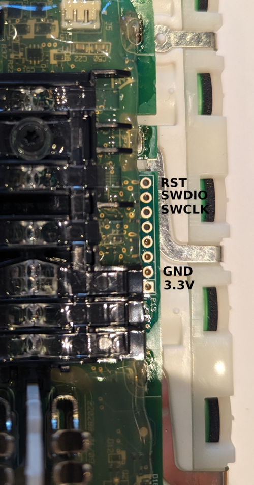

# Dyson V11 / V15 BMS firmware

Replacement firmware for compatible Dyson battery management boards, based on
[davidmpye/V10_Dyson_BMS](https://github.com/davidmpye/V10_Dyson_BMS).

> [!CAUTION]
> Lithium-ion packs can deliver enough current to cause fire or serious injury.
> Avoid shorts, insulate loose wires, and never drill into a closed pack.
> This is experimental firmware. Use it at your own risk.

## Compatible boards

Check the electronics inside the battery before flashing. The firmware needs an
**ATSAMD20E15 MCU**, a **BQ7693003 BMS frontend** (I2C address `0x08`), and
**7 cells in series (7S)**.

| Battery | Trigger setting |
|---------|-----------------|
| V11, click-in or screw-in | `TRIGGER_TOGGLE_MODE=0` (hold to run) |
| V15 with the hardware above | `TRIGGER_TOGGLE_MODE=0` |
| V12 with the hardware above | `TRIGGER_TOGGLE_MODE=1` (press to run/stop; hold 1 second to stop) |

The model name alone does not guarantee compatibility. V10 boards, LPC804-based
boards, and motor controllers are not supported.

Settings are in [config.h](V11_BMS/src/config.h). UART logging is enabled by
default through `SERIAL_DEBUG=1` and `PROT_DEBUG_PRINT=1`.

## Get the firmware

Download `samd20_firmware.hex` from the
[releases page](https://github.com/vladislav1983/V11_Dyson_BMS/releases), or build
it using the steps below. Have the replacement image ready **before unlocking**
the MCU.

### Linux / WSL

You need CMake 3.20+, ARM GCC, GNU Make, and Newlib. On Ubuntu/Debian:

```bash
sudo apt update
sudo apt install build-essential cmake gcc-arm-none-eabi libnewlib-arm-none-eabi
```

From the repository root:

```bash
cd V11_BMS
cmake -S . -B build-linux -G "Unix Makefiles" "-DCMAKE_TOOLCHAIN_FILE=cmake/arm-none-eabi.cmake" "-DCMAKE_BUILD_TYPE=Release"
cmake --build build-linux --parallel
```

The ELF and HEX files are in `V11_BMS/build-linux/`. After changing source files,
repeat only the build command. WSL can build without USB access; flashing from
WSL requires [attaching the probe](https://learn.microsoft.com/en-us/windows/wsl/connect-usb),
or you can flash the image from Windows.

### Windows / PowerShell

Install CMake and ARM GCC. The example below uses the toolchain and Make bundled
with Atmel Studio 7; adjust the paths for your installation. Start at the
repository root:

```powershell
cd V11_BMS
$env:Path = "C:\Program Files (x86)\Atmel\Studio\7.0\toolchain\arm\arm-gnu-toolchain\bin;" + $env:Path
cmake -S . -B build-stlink -G "MinGW Makefiles" "-DCMAKE_TOOLCHAIN_FILE=cmake/arm-none-eabi.cmake" "-DCMAKE_BUILD_TYPE=Release" "-DCMAKE_MAKE_PROGRAM=C:/PROGRA~2/Atmel/Studio/7.0/SHELLU~1/make.exe"
cmake --build build-stlink --parallel 4
```

The ELF and HEX files are in `V11_BMS/build-stlink/`. Keep the `-D...` arguments
quoted in PowerShell, and wait for CMake configuration to succeed before
building. The `PATH` change lasts for the current terminal session.

Use separate build directories for Windows and Linux. Both Release and Debug
use `-Os` to fit in flash; Debug adds symbols. You can also open
[V11_BMS.atsln](V11_BMS.atsln) in Microchip Studio.

## Connect the programmer

The board uses SWD. Press the battery trigger just before connecting to wake the
BMS and enable its 3.3 V supply.

<p align="center">
  
</p>

Pinout image adapted from the
[V10 flashing guide](https://github.com/davidmpye/V10_Dyson_BMS/wiki/Flashing).

| Battery pad | Programmer connection |
|-------------|-----------------------|
| `SWDIO` | SWDIO |
| `SWCLK` | SWCLK |
| `GND` | GND |
| `RST` | RESET/nRESET, if used by your programmer |
| `3.3V` | Target-voltage **sense input only**, if required (J-Link VTref / Atmel-ICE VTG) |

> [!WARNING]
> The battery powers itself. Never connect a programmer's 3.3 V or 5 V power
> output to it. Common ST-LINK V2 dongles have power outputs, so leave those
> pins disconnected. The same applies to Raspberry Pi and USB-UART power pins.

Keep wires short. If the target is not detected, wake the pack again and check
its 3.3 V rail, common ground, and SWD wiring.

## ST-LINK V2 with OpenOCD

Use [xPack OpenOCD](https://github.com/xpack-dev-tools/openocd-xpack/releases)
and the supplied [ST-Link configuration](V11_BMS/openocd_samd20_stlink.cfg).
OpenOCD 0.12.0 or newer is needed for this configuration. If programming fails
with `Error: Size 1 not supported`, use **xPack OpenOCD 0.12.0-2**, the version
reported to work in [issue #34](https://github.com/vladislav1983/V11_Dyson_BMS/issues/34).

The commands below work in PowerShell. Run them from `V11_BMS` with `openocd`
on your `PATH`. To use a specific installation, replace `openocd` with
`& "C:\path\to\openocd.exe"`.

### How to unlock ATSAMD20 MCU using an ST-LINK V2

This procedure was shared by [sonwayy in issue #34](https://github.com/vladislav1983/V11_Dyson_BMS/issues/34)
for protected V11/V15 boards that fail with:

```text
Error: Failed to read memory at 0xe000ed00
Info : [samd20.cpu] AP write error, reset will not halt
```

**Unlocking erases the entire chip, including the original Dyson firmware and
saved flash data. The protected firmware cannot be backed up through SWD.**
Skip unlocking when updating an already unlocked board.

First, check protection at a low SWD speed (5 kHz):

```powershell
openocd -f openocd_samd20_stlink.cfg -c "adapter speed 5" -c "init" -c "samd20.dap apreg 0 0x00 0xa2000000" -c "samd20.dap apreg 0 0x04 0x41002102" -c "samd20.dap apreg 0 0x0c" -c "shutdown"
```

In the reported setup, `0x00030000` meant protection was enabled. To erase the
chip, use the direct DAP commands below. They access the DSU without relying on
the blocked CPU memory access:

```powershell
openocd -f openocd_samd20_stlink.cfg -c "adapter speed 5" -c "init" -c "samd20.dap apreg 0 0x00 0xa2000000" -c "samd20.dap apreg 0 0x04 0x41002100" -c "samd20.dap apreg 0 0x0c 0x00000010" -c "sleep 2000" -c "samd20.dap apreg 0 0x00 0xa2000000" -c "samd20.dap apreg 0 0x04 0x41002101" -c "samd20.dap apreg 0 0x0c" -c "shutdown"
```

The reported result was `0x00000300`: erase complete, reset extension still
active, and no error flags in the status byte. Run the protection check again;
the reported value after unlocking was `0x00000000`. See issue #34 for the
separate reset-status check and full logs.

### Program and start the firmware

Place the downloaded `samd20_firmware.hex` in `V11_BMS`, or replace its path in
the command with your build output, such as `build-stlink/samd20_firmware.hex`
or `build-linux/samd20_firmware.hex`:

```powershell
openocd -f openocd_samd20_stlink.cfg -c "adapter speed 50" -c "reset_config none" -c "cortex_m reset_config sysresetreq" -c "init" -c "program samd20_firmware.hex verify" -c "reset halt" -c "cortex_m vector_catch none" -c "resume" -c "sleep 500" -c "poll" -c "shutdown"
```

Look for `Programming Finished`, `Verified OK`, and a running target. This
sequence uses a software reset and explicitly resumes the CPU so it can run
with ST-Link still attached. After unlocking, program the replacement firmware
before disconnecting. Verification checks the written image; check battery
operation separately as described below.

## Other programmers

- **J-Link:** in SEGGER J-Flash, select `ATSAMD20E15`, SWD, and start at 1 MHz.
  Wake the battery, erase/unsecure it if protected, then program and verify the
  ELF or HEX file and reset. For OpenOCD, use `openocd_samd20.cfg`.
  The project's `make flash` target selects J-Link.
- **Atmel-ICE:** in Microchip Studio, open **Tools -> Device Programming**,
  select Atmel-ICE / ATSAMD20E15 / SWD, read the signature, erase if protected,
  and program. OpenOCD users can use `openocd_samd20_ice.cfg`.
- **PICkit 4/5:** use MPLAB X or IPE with ATSAMD20E15 and SWD wiring.
  This method has not been validated on a Dyson pack by the maintainers.
- **Generic CMSIS-DAP:** experimental; see
  [issue #27](https://github.com/vladislav1983/V11_Dyson_BMS/issues/27).
  Use your probe's own interface configuration; the Atmel-ICE file is specific
  to that adapter.
- **Raspberry Pi GPIO:** an unmaintained community method described in the
  [V10 guide](https://github.com/davidmpye/V10_Dyson_BMS/wiki/Flashing#flashing-with-a-raspberry-pi-as-the-programmer).
  Use this project's firmware and do not connect the Pi's 3.3 V power pin.

Erasing a protected MCU with any programmer permanently removes its original
firmware. If communication is unreliable, lower the SWD speed to 100 kHz.

## UART logs and first boot

Use a **3.3 V USB-UART adapter at 115200 baud, 8N1**:

| Connection | Battery pad |
|------------|-------------|
| Adapter RX | PA10/TX: first unlabeled header pad next to `GND`, toward `SWCLK` |
| Adapter GND | GND |

Leave adapter TX and power disconnected. With logging enabled, the firmware
prints cell voltages, pack voltage, capacity, state changes, and faults.

Before fitting the battery to the vacuum, confirm that all seven cell readings
look reasonable, their sum roughly matches the pack voltage, no unexpected
faults appear, and charge/discharge switching works.

### Capacity calibration

With fresh EEPROM defaults, capacity starts at `PACK_MAX_CAPACITY_MAH` and the
charge level at 50%. The displayed percentage and runtime need calibration:

1. Use the vacuum until the BMS stops discharge at its low-voltage cutoff.
2. Fully charge the pack, allowing all three pause/retry cycles to finish.

The firmware learns capacity from this full cycle. Later partial charges keep
the learned capacity; a full discharge followed by a full charge updates it.

To reset learned values, press the trigger **20 times while actively charging**,
with less than **5 seconds between presses**. The left error LED blinks 10 times
to confirm.

## If something goes wrong

| Problem | What to check |
|---------|---------------|
| `Error: open failed` | Check the USB cable, probe driver, and other apps using the probe. |
| `Error connecting DP` / `cannot read IDR` | Wake the pack, check 3.3 V and GND, verify SWDIO/SWCLK, and shorten the wires. |
| `Failed to read memory at 0xe000ed00` | Follow the ST-Link unlock procedure above if the MCU is protected. |
| `Size 1 not supported` | Try xPack OpenOCD 0.12.0-2, as reported in issue #34. |
| No UART output | Check 115200 8N1, adapter RX to battery TX, common GND, and battery wake-up. |
| Vacuum does not run | Check board compatibility, `TRIGGER_TOGGLE_MODE`, serial wiring, and logged faults. |
| CMake cannot find `CMakeLists.txt` | Run configuration from `V11_BMS`. Use a fresh build directory for stale caches. |
| Missing `nano.specs` / `libc_nano.a` | Install Newlib for your ARM toolchain. |

When opening an issue, include the battery/SV number, PCB and MCU markings,
board photos, adapter and software versions, exact command, full programmer
log, and UART readings if available.

## License

[GNU GPL v3 or later](LICENSE). See [CREDITS.md](CREDITS.md) for contributors.
